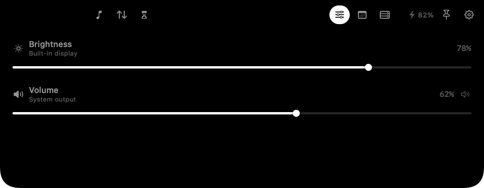

<p align="center">
  
</p>

<h1 align="center">lost_Island</h1>

A minimal, native dynamic island for the MacBook notch. Music, network data,
Screen Time, system controls, calendar and a server slot — built with SwiftUI
and AppKit, with no Electron, no web views and no analytics. When idle it
disappears into the notch; hover the notch to open it.

<p align="center">
  
</p>

## What it does

- **Music that actually follows the system.** Apple Music, Spotify and browser
  playback (Safari, Chrome, Brave, Arc, Firefox, Zen) appear in the island with
  artwork, title, artist, source app, scrubbable progress and transport
  controls.
- **Network data on hover.** Today's download/upload total, a live rate and a
  seven-day chart — in the expanded card only, so the collapsed notch stays
  clean.
- **Screen Time.** Today's frontmost-app time, a stacked app breakdown, top
  apps and a local estimate that starts the moment lost_Island is running.
- **Volume and brightness.** Thin, fast sliders backed by CoreAudio and
  DisplayServices. Mute with one click.
- **Calendar.** Today's events, an ongoing-event highlight, and a **Join**
  button when an event contains a meeting link.
- **Server status with Beszel.** Every system in your hub — Server1, Raspberry
  Pi, etc. — with CPU, RAM, disk, uptime and network ↓/↑, read with a read-only
  user.
- **Battery.** A tiny battery/charging readout in the expanded header.
- **Configurable.** Enable or disable any module, pin it open, or let it expand
  on hover.
- **Calm motion.** A spring-based morph with a sliding tab pill and a soft
  content scale. The collapsed island is the notch silhouette, not a bar that
  extends into the menu bar.

<p align="center">
  
  
</p>
<p align="center">
  
  
</p>
<p align="center">
  
</p>

## Installation

### Homebrew

```bash
brew tap dhivyadhanush/islet
brew trust dhivyadhanush/islet
brew install --cask lost-island
```

On the first launch, right-click **lost_Island** in Applications and choose
**Open**. The app is ad-hoc signed, so macOS will not accept a double-click
until you approve it once. If macOS still blocks it, run:

```bash
sudo xattr -dr com.apple.quarantine /Applications/lost_Island.app
open /Applications/lost_Island.app
```

## Using lost_Island

1. **Hover the notch.** The collapsed island is the notch silhouette. The tab
   strip appears in the menu-bar wings: Music, Network and Screen Time on the
   left of the notch; Controls, Calendar and Server on the right.
2. **Click a tab.** The pane hangs below the notch. The pin keeps it open; the
   gear opens Settings.
3. **Choose Server metrics.** Settings → **Server metrics**: tick CPU, RAM,
   Disk and Network. Only the checked metrics appear; the remaining ones
   auto-justify across the full row and the system rows share the height
   (uncheck Network and CPU/RAM/Disk spread edge-to-edge). CPU, RAM and Disk
   also show a percentage bar under the value. The status dot is green when the
   machine is online and red when it is not; bars are green below 40%, blue
   from 40% to 79%, and red at 80% and above.
4. **Choose modules.** Settings → **Modules**: enable or disable any tab.
5. **Connect Beszel.** Settings → **Server (Beszel)**: hub URL, read-only
   email/password, optional Cloudflare Access Client ID/Secret.
6. **Tune the island.** Settings → **Behavior** (hover, battery, launch at
   login) and **Motion** (calm animations).
7. **Menu bar item:** show/hide, settings, launch at login, quit.

Click anywhere outside the island to close it.

## Browser media

macOS 15.4 stopped returning now-playing data to ordinary apps through the old
MediaRemote C API. lost_Island ships a small local helper (`IsletMedia.dylib`,
loaded by the Apple-signed `/usr/bin/perl`) that reads the system's now-playing
dictionary and streams it to the app. That is why browser playback now shows up.

- No network access, no analytics, no automation permission in the normal path.
- If a site does not publish Media Session metadata, macOS Control Center will
  not show it either, and lost_Island cannot invent it. Normal audio/video on Safari,
  Chrome, Brave, Arc and Firefox does publish it.
- If you ever see **Media → Fallback** in Settings, lost_Island could not start the
  helper and is using the older in-process API.

## Server status with Beszel

The Server tab talks to your **Beszel** hub. It does not shell out or run a
generic ping.

1. **Expose Beszel on your domain.** Cloudflare Zero Trust → Networks →
   Tunnels → the tunnel that serves `dhanush-vijay.uk` → Public Hostname:
   `beszel` / `dhanush-vijay.uk`, service `HTTP` → `172.17.0.1:8090`.
2. **Create a read-only Beszel user** in Beszel → Settings → Users (role
   `readonly`).
3. **Optional Access.** Add a self-hosted Cloudflare Access application for
   `beszel.dhanush-vijay.uk` with your email/OTP policy. For the island, create
   an Access **service token** and add a Service Auth policy.
4. **Configure the island.** Settings → Server (Beszel): hub URL
   `https://beszel.dhanush-vijay.uk`, read-only email/password, and the Access
   Client ID/Secret if Access is on. Save & Test.
5. The tab lists every system the account can see. In the screenshot, `Server1`
   and `Raspberry Pi` are separate rows; the Pi row includes `wlan0 ↓/↑` from
   Beszel's `b` and `ni` network data. It refreshes every 30 s.

For a local test before the domain is ready:

```bash
ssh -N -L 8090:127.0.0.1:8090 -J pi@100.117.187.32 server1@192.168.1.22
```

Then use `http://127.0.0.1:8090` in Settings. The CLI can verify credentials:

```bash
BESZEL_URL=https://beszel.dhanush-vijay.uk \
BESZEL_EMAIL=you@example.com \
BESZEL_PASSWORD='…' \
./build/lost_Island.app/Contents/MacOS/lost_Island --beszel-test
```

If Cloudflare Access is on, add `CF_ACCESS_CLIENT_ID` and
`CF_ACCESS_CLIENT_SECRET` to that command.

API used: `POST /api/collections/users/auth-with-password`,
`GET /api/collections/systems/records`,
`GET /api/collections/system_stats/records`. The password and Access secret are
stored locally in
`~/Library/Application Support/lost_Island/credentials.json` with 0600
permissions; the hub URL, email and Access client ID live in UserDefaults.

### Raspberry Pi agent

The Pi (`Rasberry`, armv7 Raspbian) runs the armv7 Beszel agent as a systemd
service:

| | |
|---|---|
| Package | `beszel-agent_0.21.1_linux_armv7.deb` |
| Binary | `/usr/bin/beszel-agent` |
| Service | `beszel-agent.service` (enabled) |
| Config | `/etc/beszel-agent.conf` |
| Hub | `HUB_URL=http://192.168.1.22:8090` |
| Auth | `KEY` (hub public key) + `TOKEN` (system fingerprint token) |

The hub shows the Pi as its own system; the island lists it under Server1 with
`wlan0` network throughput. The agent connects outbound to the hub over
WebSocket and also exposes its SSH server on `45876`.

## Build from source

Requirements: macOS 14+, Xcode or Command Line Tools, and a Mac with a notch
for the full effect (on other displays lost_Island becomes a floating pill).

```bash
git clone https://github.com/dhivyadhanush/islet.git
cd islet
./build.sh
open build/lost_Island.app
```

Universal binary:

```bash
ARCHS="arm64 x86_64" ./build.sh
```

Useful diagnostics:

```bash
./build/lost_Island.app/Contents/MacOS/lost_Island --diagnose
./build/lost_Island.app/Contents/MacOS/lost_Island --snapshot build/snapshots
./build/lost_Island.app/Contents/MacOS/lost_Island --beszel-test
```

`--snapshot` renders the island offscreen to PNGs, which is how the images above
were produced.

## Permissions

| Feature | Permission |
| --- | --- |
| Music / browser media | None (system now-playing service) |
| Network | None (kernel interface counters) |
| Screen Time | None (local frontmost-app tracker) |
| Server status | Beszel read-only login (+ optional Cloudflare Access service token) |
| Volume | None (CoreAudio) |
| Brightness | None (DisplayServices, built-in display) |
| Calendar | Calendar access, requested when you tap **Connect** |

lost_Island is not sandboxed because brightness and the media helper need
system frameworks. It does not send data anywhere.

## Configuration

Open **Settings** from the menu bar or the gear in the island.

- Modules: Music, Network, Screen Time, Controls, Calendar, Server.
- Server metrics: CPU / RAM / Disk / Network checkboxes (only checked metrics
  show; the rest auto-fill the row). CPU/RAM/Disk include a percentage bar and
  a green/red online dot per system.
- Behavior: expand on hover, battery in header, launch at login.
- Motion: Calm animations.
- Network: today's total, live rate and a reset button.
- Screen Time: today's total and a reset button.
- Server: Beszel hub URL, read-only email/password, optional Cloudflare Access service token.
- Media: helper status.
- Permissions: calendar status and a shortcut to System Settings.

## Known limitations

- **Screen Time is a local estimate.** macOS does not expose system Screen Time
  totals to third-party apps without Full Disk Access or a DeviceActivity report
  extension. lost_Island tracks the frontmost app while it runs and excludes idle and
  sleep time; it does not include usage before lost_Island launched.
- **Server status needs Beszel.** Configure a read-only Beszel user; until then
  the Server tab shows a setup prompt. If Cloudflare Access is enabled, the app
  also needs an Access service token.
- Brightness applies to the built-in display. External displays are left alone.
- **No custom volume/brightness HUD.** macOS draws its own volume and brightness
  overlay through Control Center, and there is no public API to suppress it.
  lost_Island therefore leaves those to the system instead of drawing a second
  bar in the notch.
- The app is ad-hoc signed. A Developer ID build would remove the Gatekeeper
  warning; the source is here if you want to sign it yourself.
- Calendar access is read-only.

## Architecture

```
SwiftUI island (NSPanel, .statusBar, non-activating)
├── collapsed          the notch silhouette (square top, 12 pt bottom radius)
├── ExpandedView       sliding tabs + battery + pin + settings
│   ├── MusicPane      MediaRemote helper + seek + source badge
│   ├── NetworkPane    daily totals, live rate and 7-day chart
│   ├── ScreenTimePane local frontmost-app tracker + app breakdown
│   ├── ControlsPane   CoreAudio volume + DisplayServices brightness
│   ├── CalendarPane   EventKit + meeting-link Join
│   └── ServerPane     Beszel status + CPU/RAM/disk/uptime
└── Services           NowPlaying, NetworkMonitor, ScreenTimeService,
                       SystemControls, CalendarService, BatteryMonitor,
                       ServerStatusService, BeszelClient, CredentialStore, MediaBridge
```

The collapsed window is exactly the notch plus a 10 pt transparent hover margin.
The expanded window keeps the top edge flush and adds 10 pt of transparent room
on each side and below so the spring overshoot is never clipped.

## Credits

- The MediaRemote helper technique (loading a dylib into the system-signed perl
  process) is adapted from [nowplaying-cli](https://github.com/kirtan-shah/nowplaying-cli)
  and its `mediaremote-mini` adapter (BSD-3-Clause). See `NOTICE`.
- Design inspiration: Atoll, Boring.Notch and the iOS Dynamic Island.

## License

MIT. See `LICENSE`.
