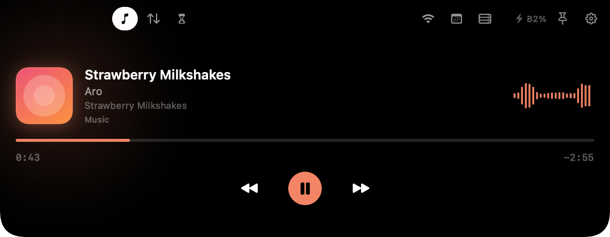
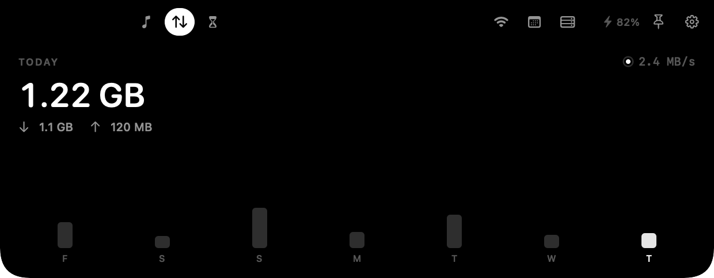
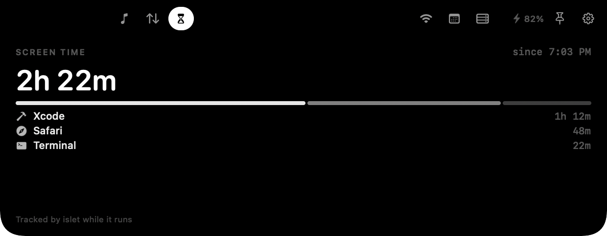
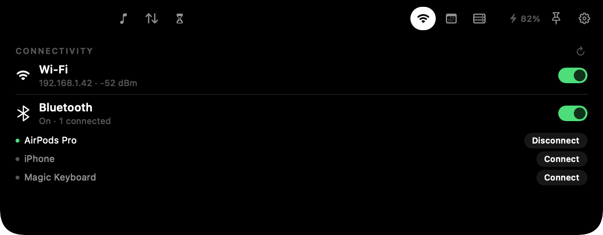
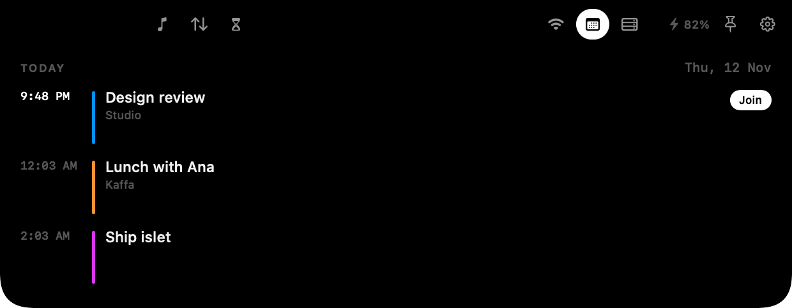
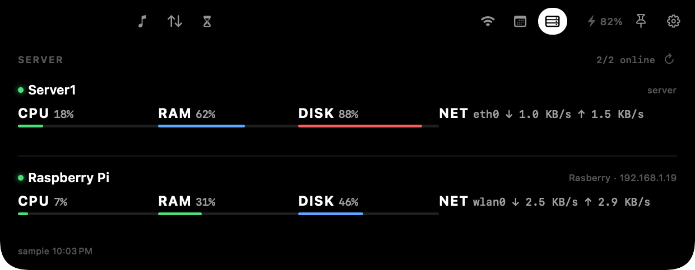

<p align="center">
  
</p>

<h1 align="center">islet</h1>

A minimal, native dynamic island for the MacBook notch. Music, network data,
Screen Time, Wi-Fi/Bluetooth, calendar and a server slot — built with SwiftUI
and AppKit, with no Electron, no web views and no analytics. When idle it
disappears into the notch; hover the notch to open it.

<p align="center">
  
</p>

## What it does

- **Music that actually follows the system.** Apple Music, Spotify and browser
  playback (Safari, Chrome, Brave, Arc, Firefox, Zen) appear in the island with
  artwork, title, artist, source app, scrubbable progress and transport
  controls. The progress bar, play button and artwork glow take their colour
  from the current cover, and a flowing sound wave shows the track is live.
  Playback state is checked against CoreAudio's per-process output, so a stale
  browser media session does not keep the player or the chip visible after the
  sound stops.
- **Now-playing chip beside the notch.** While audio is playing, a small black
  chip with the cover thumbnail and a live bar waveform sits in the menu bar
  immediately left of the notch. Click it to open the Music tab; it disappears
  when playback stops or the island expands. macOS does not allow third-party
  status items left of the notch, so the chip is drawn by the island at
  status-bar level.
- **Network data on hover.** Today's download/upload total, a live rate and a
  seven-day chart — in the expanded card only, so the collapsed notch stays
  clean.
- **Screen Time.** Today's frontmost-app time, a stacked app breakdown, top
  apps and a local estimate that starts the moment islet is running.
- **Wi-Fi and Bluetooth.** Toggle either radio, see the Wi-Fi address and
  signal, and connect or disconnect paired Bluetooth devices from the
  Connectivity tab.
- **Calendar.** Today's events, an ongoing-event highlight, and a **Join**
  button when an event contains a meeting link.
- **Server status with Beszel.** Every system in your hub — Server1, Raspberry
  Pi, etc. — with CPU, RAM, disk, uptime and network ↓/↑, read with a read-only
  user.
- **Battery.** A tiny battery/charging readout in the expanded header.
- **Configurable.** Enable or disable any module, pin it open, or let it expand
  on hover.
- **Calm motion.** A spring-based morph with a sliding tab pill and a soft
  content scale. The collapsed island is the notch silhouette, not a bar that
  extends into the menu bar.

<p align="center">
  
  
</p>
<p align="center">
  
  
</p>
<p align="center">
  
</p>

## Installation

### Homebrew

```bash
brew tap dhivyadhanush/islet
brew trust dhivyadhanush/islet
brew install --cask islet
```

On the first launch, right-click **islet** in Applications and choose
**Open**. The app is ad-hoc signed, so macOS will not accept a double-click
until you approve it once. If macOS still blocks it, run:

```bash
sudo xattr -dr com.apple.quarantine /Applications/islet.app
open /Applications/islet.app
```

Upgrading from the old **lost_Island** cask (pre-1.0)? Remove it once, then
install `islet`:

```bash
brew uninstall --cask lost-island
brew install --cask islet
```

Your Beszel credentials move automatically from
`~/Library/Application Support/lost_Island/` to `~/Library/Application Support/islet/`
on first launch.

## Using islet

1. **Hover the notch.** The collapsed island is the notch silhouette. The tab
   strip appears in the menu-bar wings: Music, Network and Screen Time on the
   left of the notch; Connectivity, Calendar and Server on the right.
2. **Click a tab.** The pane hangs below the notch. The pin keeps it open; the
   gear opens Settings.
3. **Use Connectivity.** Toggle Wi-Fi or Bluetooth, check the Wi-Fi address and
   signal, and connect or disconnect a paired Bluetooth device. The first
   Bluetooth access may ask for permission.
4. **Choose Server metrics.** Settings → **Server metrics**: tick CPU, RAM,
   Disk and Network. Only the checked metrics appear; the remaining ones
   auto-justify across the full row and the system rows share the height
   (uncheck Network and CPU/RAM/Disk spread edge-to-edge). CPU, RAM and Disk
   also show a percentage bar under the value. The status dot is green when the
   machine is online and red when it is not; bars are green below 40%, blue
   from 40% to 79%, and red at 80% and above.
5. **Choose modules.** Settings → **Modules**: enable or disable any tab.
6. **Connect Beszel.** Settings → **Server (Beszel)**: hub URL, read-only
   email/password, optional Cloudflare Access Client ID/Secret.
7. **Tune the island.** Settings → **Behavior** (hover, battery, start at
   login) and **Motion** (calm animations).
8. **Save your preferences.** Settings changes are drafted locally; press
   **Save** (⌘S) to apply them and close the window, or **Revert** to discard.
   Nothing changes in the island until you save.
9. **Menu bar item:** show/hide, settings, start at login, quit. While music
   plays, a small waveform chip appears just left of the notch; click it to
   open the Music tab.

Click anywhere outside the island to close it.

## Connectivity

The **Connectivity** tab (the Wi-Fi glyph in the right wing) replaces the old
volume/brightness sliders — the keyboard and Control Center already handle those.

<p align="center">
  
</p>

### Wi-Fi
- Turn the radio on or off with the switch.
- The subtitle shows the interface address and signal, for example
  `192.168.1.42 · -52 dBm`.
- macOS hides the SSID from apps without Location permission, so the network
  name is not shown; the address is.
- Changes apply immediately and the pane refreshes every 5 seconds.

### Bluetooth
- Turn Bluetooth on or off with the switch.
- Paired devices are listed with a green dot when connected and a grey dot when
  not.
- **Connect** / **Disconnect** acts on that device. It must be awake and in
  range, and macOS may ask for Bluetooth access the first time.

Hide the tab in **Settings → Modules** if you do not need it.

## Browser media

macOS 15.4 stopped returning now-playing data to ordinary apps through the old
MediaRemote C API. islet ships a small local helper (`IsletMedia.dylib`,
loaded by the Apple-signed `/usr/bin/perl`) that reads the system's now-playing
dictionary and streams it to the app. That is why browser playback now shows up.

- No network access, no analytics, no automation permission in the normal path.
- Artwork and its accent colour follow the system's now-playing data. Browsers
  fetch Media Session artwork asynchronously, so islet keeps polling until the
  cover arrives instead of only reading it on the first metadata update. A
  greyscale cover has no hue to sample, so the player falls back to white.
- If a site does not publish Media Session metadata, macOS Control Center will
  not show it either, and islet cannot invent it. Normal audio/video on Safari,
  Chrome, Brave, Arc and Firefox does publish it.
- If you ever see **Media → Fallback** in Settings, islet could not start the
  helper and is using the older in-process API.

## Server status with Beszel

The Server tab talks to your **Beszel** hub. It does not shell out or run a
generic ping.

1. **Expose Beszel on your domain.** Cloudflare Zero Trust → Networks →
   Tunnels → the tunnel that serves `dhanush-vijay.uk` → Public Hostname:
   `beszel` / `dhanush-vijay.uk`, service `HTTP` → `172.17.0.1:8090`.
2. **Create a read-only Beszel user** in Beszel → Settings → Users (role
   `readonly`).
3. **Optional Access.** Add a self-hosted Cloudflare Access application for
   `beszel.dhanush-vijay.uk` with your email/OTP policy. For the island, create
   an Access **service token** and add a Service Auth policy.
4. **Configure the island.** Settings → Server (Beszel): hub URL
   `https://beszel.dhanush-vijay.uk`, read-only email/password, and the Access
   Client ID/Secret if Access is on. Save & Test.
5. The tab lists every system the account can see. In the screenshot, `Server1`
   and `Raspberry Pi` are separate rows; the Pi row includes `wlan0 ↓/↑` from
   Beszel's `b` and `ni` network data. It refreshes every 30 s.

For a local test before the domain is ready:

```bash
ssh -N -L 8090:127.0.0.1:8090 -J pi@100.117.187.32 server1@192.168.1.22
```

Then use `http://127.0.0.1:8090` in Settings. The CLI can verify credentials:

```bash
BESZEL_URL=https://beszel.dhanush-vijay.uk \
BESZEL_EMAIL=you@example.com \
BESZEL_PASSWORD='…' \
./build/islet.app/Contents/MacOS/islet --beszel-test
```

If Cloudflare Access is on, add `CF_ACCESS_CLIENT_ID` and
`CF_ACCESS_CLIENT_SECRET` to that command.

To configure the installed app without opening Settings, use
`--beszel-save`. Prefer the environment or stdin so the password never appears
in the process list or your shell history:

```bash
BESZEL_URL=https://beszel.dhanush-vijay.uk \
BESZEL_EMAIL=you@example.com \
BESZEL_PASSWORD='…' \
./build/islet.app/Contents/MacOS/islet --beszel-save

printf '%s' '…' | ./build/islet.app/Contents/MacOS/islet --beszel-save \
  --beszel-url https://beszel.dhanush-vijay.uk \
  --beszel-email you@example.com \
  --beszel-password-stdin
```

The older `--beszel-password` argument still works but prints a warning because
argv is visible to other local processes.

API used: `POST /api/collections/users/auth-with-password`,
`GET /api/collections/systems/records`,
`GET /api/collections/system_stats/records`. The password and Access secret are
stored locally in
`~/Library/Application Support/islet/credentials.json` with 0600
permissions (migrated automatically from the old `lost_Island` folder); the hub
URL, email and Access client ID live in UserDefaults.

### Raspberry Pi agent

The Pi (`Rasberry`, armv7 Raspbian) runs the armv7 Beszel agent as a systemd
service:

| | |
|---|---|
| Package | `beszel-agent_0.21.1_linux_armv7.deb` |
| Binary | `/usr/bin/beszel-agent` |
| Service | `beszel-agent.service` (enabled) |
| Config | `/etc/beszel-agent.conf` |
| Hub | `HUB_URL=http://192.168.1.22:8090` |
| Auth | `KEY` (hub public key) + `TOKEN` (system fingerprint token) |

The hub shows the Pi as its own system; the island lists it under Server1 with
`wlan0` network throughput. The agent connects outbound to the hub over
WebSocket and also exposes its SSH server on `45876`.

## Build from source

Requirements: macOS 14+, Xcode or Command Line Tools, and a Mac with a notch
for the full effect (on other displays islet becomes a floating pill).

```bash
git clone https://github.com/dhivyadhanush/islet.git
cd islet
./build.sh                 # native architecture
open build/islet.app

ARCHS="arm64 x86_64" ./build.sh   # universal binary
Tests/run.sh                      # pure logic tests, no GUI required
MAKE_DMG=1 ./build.sh             # adds build/islet-<version>.dmg
```

`build.sh` keeps the previous DMG; it refuses to overwrite one unless
`OVERWRITE_DMG=1` is set. The version comes from the latest `v*` tag or
`VERSION=…`.

A Developer ID build signs with the hardened runtime and can notarize the DMG.
Create the notary profile once with
`xcrun notarytool store-credentials islet-notary …`, then:

```bash
SIGN_IDENTITY="Developer ID Application: Your Name (TEAMID)" \
NOTARY_PROFILE=islet-notary \
ARCHS="arm64 x86_64" MAKE_DMG=1 ./build.sh
```

Without `SIGN_IDENTITY` the build is ad-hoc signed, which is fine locally but
leaves the Gatekeeper warning on other Macs.

Useful diagnostics:

```bash
./build/islet.app/Contents/MacOS/islet --diagnose
./build/islet.app/Contents/MacOS/islet --snapshot build/snapshots
./build/islet.app/Contents/MacOS/islet --beszel-test
```

`--diagnose` prints the sampled artwork size and the accent colour derived from
it, so browser artwork can be checked without a screenshot. `--snapshot`
renders the island offscreen to PNGs, which is how the images above were
produced.

CI runs the tests, the build and the snapshot renderer on every push
(`.github/workflows/ci.yml`); a `v*` tag builds a universal DMG and can update
the Homebrew tap when `TAP_GITHUB_TOKEN` is configured
(`.github/workflows/release.yml`).

## Permissions

| Feature | Permission |
| --- | --- |
| Music / browser media | None in the normal path (system now-playing service); Automation only if the AppleScript fallback runs |
| Network | None (kernel interface counters) |
| Screen Time | None (local frontmost-app tracker) |
| Server status | Beszel read-only login (+ optional Cloudflare Access service token) |
| Wi-Fi | None for power/address; network name may be hidden without Location |
| Bluetooth | Bluetooth access, requested on first use |
| Calendar | Calendar access, requested when you tap **Connect** |

islet is not sandboxed because the media helper and Bluetooth control need
direct access to system frameworks. It does not send data anywhere.

## Configuration

Open **Settings** from the menu bar or the gear in the island. Changes are
drafted in the window; press **Save** (⌘S) to apply them or **Revert** to
discard. The Server section keeps its own **Save & Test** for the Beszel
connection.

- Modules: Music, Network, Screen Time, Connectivity, Calendar, Server.
- Server metrics: CPU / RAM / Disk / Network checkboxes (only checked metrics
  show; the rest auto-fill the row). CPU/RAM/Disk include a percentage bar and
  a green/red online dot per system.
- Behavior: expand on hover, battery in header, start at login.
- Motion: Calm animations.
- Network: today's total, live rate and a reset button.
- Screen Time: today's total and a reset button.
- Server: Beszel hub URL, read-only email/password, optional Cloudflare Access service token.
- Media: helper status.
- Permissions: calendar status and a shortcut to System Settings.

## Known limitations

- **Screen Time is a local estimate.** macOS does not expose system Screen Time
  totals to third-party apps without Full Disk Access or a DeviceActivity report
  extension. islet tracks the frontmost app while it runs and excludes idle and
  sleep time; audio output keeps passive media playback counted. It does not
  include usage before islet launched.
- **Server status needs Beszel.** Configure a read-only Beszel user; until then
  the Server tab shows a setup prompt. If Cloudflare Access is enabled, the app
  also needs an Access service token.
- **Wi-Fi names need Location.** macOS hides the SSID from apps without
  Location permission, so the Connectivity tab shows the interface address and
  signal instead. Toggling Wi-Fi itself needs no permission.
- **Bluetooth connect depends on the device.** A paired device must be awake and
  in range; macOS may also ask for Bluetooth access the first time.
- Release builds are ad-hoc signed. A Developer ID + notarized build removes the
  Gatekeeper warning; `build.sh` supports it, but it needs your own certificate.
- Calendar access is read-only.

## Architecture

```
SwiftUI island (NSPanel, .statusBar, non-activating)
├── collapsed          the notch silhouette (square top, 12 pt bottom radius)
├── ExpandedView       sliding tabs + battery + pin + settings
│   ├── MusicPane      MediaRemote helper + seek + source badge
│   ├── NetworkPane    daily totals, live rate and 7-day chart
│   ├── ScreenTimePane local frontmost-app tracker + app breakdown
│   ├── ConnectivityPane Wi-Fi power/address + Bluetooth power/devices
│   ├── CalendarPane   EventKit + meeting-link Join
│   └── ServerPane     Beszel status + CPU/RAM/disk/uptime
├── Services           NowPlaying, AudioActivity, NetworkMonitor,
│                      ScreenTimeService, ConnectivityService, CalendarService,
│                      BatteryMonitor, ServerStatusService, BeszelClient,
│                      BeszelParsing, CredentialStore, MediaBridge
└── Tests              pure formatters + Beszel sample parsing (Tests/run.sh)
```

`BeszelParsing` is deliberately free of URLSession and AppKit so the metrics
mapping can be unit-tested. The GitHub workflows build the app and render the
snapshots on every push.

The collapsed window is exactly the notch plus a 10 pt transparent hover margin.
The expanded window keeps the top edge flush and adds 10 pt of transparent room
on each side and below so the spring overshoot is never clipped.

## Security

islet keeps credentials in a 0600 file under Application Support, makes no
analytics calls, and only contacts the Beszel hub you configure. Report
sensitive issues privately using the Security tab (see `SECURITY.md`). Release
changes are listed in `CHANGELOG.md`.

## Credits

- The MediaRemote helper technique (loading a dylib into the system-signed perl
  process) is adapted from [nowplaying-cli](https://github.com/kirtan-shah/nowplaying-cli)
  and its `mediaremote-mini` adapter (BSD-3-Clause). See `NOTICE`.
- Design inspiration: Atoll, Boring.Notch and the iOS Dynamic Island.

## License

MIT. See `LICENSE`.
